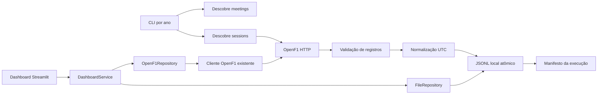

# Arquitetura e contrato

O dashboard escolhe `OpenF1Repository` por padrão e reutiliza cliente, rate limiter e retries da coleta. O modo Offline usa `FileRepository` e não abre conexões externas. Falhas online alternam para Offline quando há dados locais; respostas online ficam em cache por 60 segundos. O catálogo `/meetings` e `/sessions` é preservado em `data/<ano>/_catalog/` para que os nomes do calendário possam ser exibidos também sem conexão.

## Fronteiras

- `ingestion.client`: HTTP, codificação de filtros, timeout e retries limitados para falhas transitórias.
- `validation`: aceita objetos JSON e preserva campos opcionais; rejeita linhas que não sejam objetos e linhas cujo `session_key` conflite com a consulta.
- `transformations`: converte campos ISO de data para UTC e preserva o valor original em `_source_dates`; datas inválidas permanecem como vieram.
- `storage`: substituição atômica de um arquivo JSONL por vez.
- `services.collect`: coordena leitura, validação, transformação, gravação e manifesto.

## Contrato e rastreabilidade

Granularidade de saída é um registro OpenF1 por linha JSONL, particionado por ano e sessão, separado por endpoint. Identificadores da fonte e campos extras são preservados. Datas com nome `date` ou sufixo `_date` são publicadas em UTC; o texto original é guardado em `_source_dates`. O manifesto contém versão do contrato, endpoint, filtros, contagens, chaves de reunião/sessão, duração e `run_id`. Payloads não são escritos nos logs.

## Persistência e recuperação

JSONL local é uma decisão provisória até que o caso de análise e o volume indiquem o destino definitivo. Unidade de reprocessamento: sessão. Reexecutar substitui cada snapshot de endpoint e evita duplicação por append. Cada arquivo é atômico; o conjunto de vários endpoints não tem transação conjunta. Se uma publicação falhar, execute novamente a mesma sessão; use o manifesto para diagnosticar o estado. Não há watermark. Execuções concorrentes para a mesma sessão não são coordenadas e a última substituição de cada arquivo vence.

A API pode atrasar a publicação de resultados e grid. Uma resposta vazia é persistida como arquivo vazio, então reexecute a sessão após a atualização da fonte para preencher snapshots recentes.
