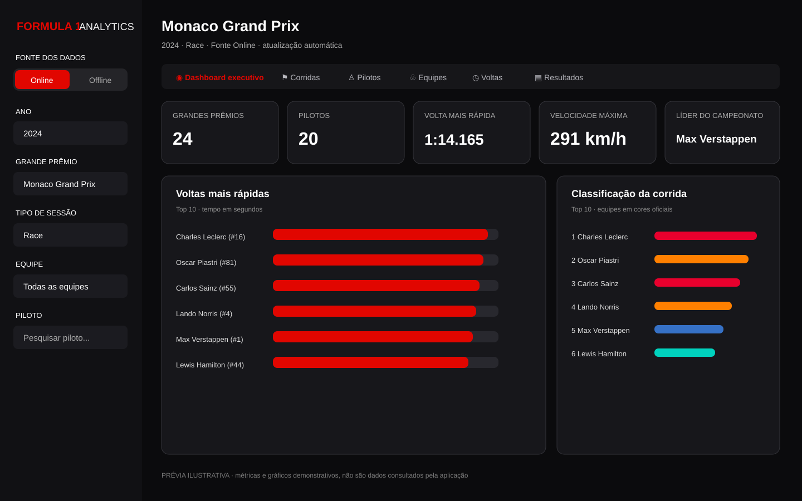

# Dashboard F1 Analytics

O dashboard Streamlit possui duas fontes de dados. **Online** é o padrão e usa o cliente OpenF1 existente, com seu rate limiter compartilhado e retries. **Offline** lê os snapshots JSONL em `data/<ano>/<session_key>/` e não faz chamadas externas. As respostas online ficam em cache por um minuto e a interface atualiza automaticamente. Quando uma chamada da OpenF1 falha, o dashboard muda para Offline se houver dados locais.

## Execução local

```powershell
poetry install
poetry run f1 --year 2024
poetry run dashboard
```

O coletor existente continua disponível sem alterações no comando `poetry run f1 --year 2024`. Além dos endpoints, ele persiste as respostas de `/meetings` e `/sessions` em `data/<ano>/_catalog/`, permitindo que o modo Offline mostre os nomes oficiais de Grandes Prêmios e sessões. O modo Online também mantém esse catálogo localmente. Pastas de dados antigas sem catálogo usam o rótulo amigável `Grand Prix N` até o catálogo ser atualizado online ou o coletor ser executado novamente.

## Páginas e filtros

As páginas são Dashboard executivo, Corridas, Pilotos, Equipes, Voltas e Resultados. A barra lateral permite escolher ano, Grande Prêmio, tipo de sessão, equipe e piloto. A lista de pilotos e as cores das equipes vêm dos dados `/drivers`; nomes de corridas vêm de `/meetings`.

O dashboard executivo mostra quantidade de Grandes Prêmios e sessões, pilotos, volta mais rápida, velocidade máxima e liderança. Offline, as métricas de volta, velocidade e pontos são calculadas com os dados locais da temporada. Online, os campeonatos e as métricas de corrida usam os endpoints disponíveis para o Grande Prêmio selecionado. A página Resultados compara a classificação de equipes entre a temporada selecionada e a anterior quando a OpenF1 disponibiliza esses dados.

## Autenticação OpenF1

Dados históricos podem ser acessados sem autenticação. O acesso a dados ao vivo exige assinatura OpenF1 e credenciais OAuth2. Para execução local, crie `.streamlit/secrets.toml` (não versionado) com:

```toml
[openf1]
username = "seu-email-da-conta"
password = "sua-senha"
```

O dashboard obtém e renova o token de curta duração no servidor. Também aceita `OPENF1_USERNAME` e `OPENF1_PASSWORD`. Um bearer token previamente emitido pode ser informado em `F1_API_TOKEN`, mas expira; prefira credenciais. Nunca versione secrets.

## Deploy

O `Dockerfile` pode ser usado no Render, Railway e Azure App Service. O entrypoint vincula o servidor a `0.0.0.0` e usa a variável `PORT` da plataforma. Configure `OPENF1_USERNAME` e `OPENF1_PASSWORD` como secrets para habilitar dados ao vivo. No Streamlit Community Cloud, publique o repositório, use `poetry run dashboard` como comando e cadastre os secrets nas configurações. Online é o padrão e não depende de volume local persistente; os JSONL locais são fallback opcional.

O rate limiter atual é compartilhado entre chamadas do mesmo processo Python. Para escalar horizontalmente, mantenha um único worker ou mova o estado do rate limiter para um backend compartilhado antes de criar réplicas.

## Imagem simulada da interface



Este mockup demonstra hierarquia visual, filtros, cartões e gráficos. Os valores exibidos são ilustrativos e não foram consultados pela aplicação.

## Qualidade

```powershell
poetry run ruff check .
poetry run pytest tests/unit --cov=f1 --cov-report=term-missing --cov-fail-under=50
poetry run mkdocs build
```
